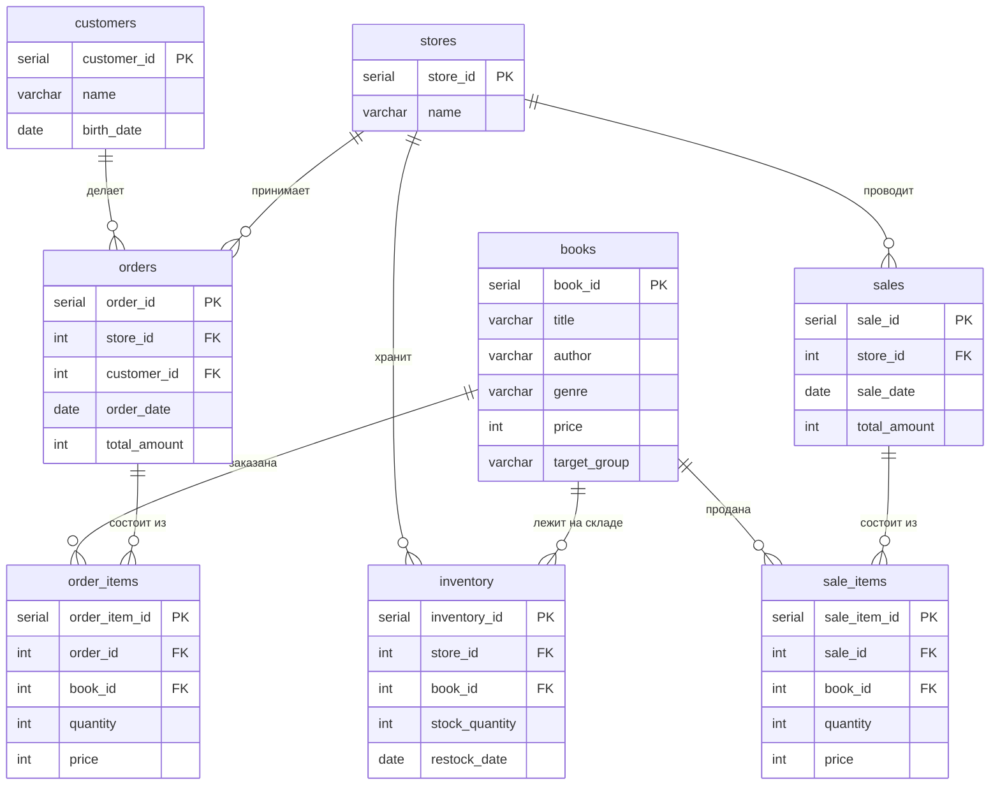

# Bookstore Database

Реляционная база данных книжного магазина на PostgreSQL: схема со связями, аналитический SQL,
аналитические функции на PL/pgSQL, триггеры и разграничение прав через роли.

**Задача:** хранить клиентов, книги, магазины, склад, заказы и продажи так, чтобы по этим данным
можно было считать аналитику - топ книг, средний чек по жанрам и сезонам, популярность книг
в разных возрастных группах.

## Схема



## Что внутри

| Файл | Что делает |
|---|---|
| `sql/01_schema.sql` | 8 таблиц: первичные ключи, внешние связи, `CHECK`-ограничения, индексы по внешним ключам |
| `sql/02_seed.sql` | демонстрационные данные: 10 клиентов, 10 книг, 10 магазинов, заказы в разные сезоны |
| `sql/03_functions.sql` | 4 аналитические функции на PL/pgSQL (`RETURNS TABLE`) |
| `sql/04_triggers.sql` | триггер `BEFORE INSERT` с подстановкой значений по умолчанию |
| `sql/05_roles.sql` | 4 роли и пользователи, `GRANT` на таблицы, последовательности и функции |
| `queries/analytics.sql` | выборки: джойны, агрегаты, подзапросы, вызов функций |
| `queries/benchmark.sql` | сравнение планов запросов до и после индексов (`EXPLAIN ANALYZE`) |

## Функции

| Функция | Что считает |
|---|---|
| `get_most_ordered_books()` | книги, которые заказывали чаще всего |
| `get_avg_check_by_genre()` | средний чек заказов по жанрам |
| `get_avg_check_by_season()` | средний чек и число заказов по сезонам (`CASE` + `EXTRACT`) |
| `get_books_popularity_by_age_group()` | рейтинг книг внутри возрастных групп: CTE + `RANK() OVER (PARTITION BY ...)` |

Вызов - как обычный `SELECT`:

```sql
SELECT * FROM get_avg_check_by_season();
```

## Роли

| Роль | Права |
|---|---|
| `operator_bd` | читает каталог, принимает товар на склад |
| `user_bd` | полный CRUD по данным магазина |
| `analyst_bd` | только `SELECT` и вызов аналитических функций |
| `admin_bd` | полный доступ |

Пароли в `05_roles.sql` демонстрационные - это осознанное упрощение для локального запуска.

## Запуск

### Docker

```bash
docker compose up -d
```

Скрипты из `sql/` применятся автоматически при первом старте контейнера, по алфавиту.
База поднимется на порту `5433`.

```bash
psql -h localhost -p 5433 -U postgres -d bookstore -f queries/analytics.sql
```

### Локальный PostgreSQL

```bash
createdb bookstore
psql -d bookstore -f sql/01_schema.sql
psql -d bookstore -f sql/02_seed.sql
psql -d bookstore -f sql/03_functions.sql
psql -d bookstore -f sql/04_triggers.sql
psql -d bookstore -f sql/05_roles.sql
```

Порядок важен: функции и триггеры ссылаются на таблицы, роли - на функции.

## Примеры запросов

```sql
-- книги дороже средней цены по своему жанру
SELECT title, genre, price
FROM books b
WHERE price > (SELECT AVG(price) FROM books b2 WHERE b2.genre = b.genre)
ORDER BY genre, price DESC;

-- самый дорогой заказ каждого клиента
SELECT c.name, o.order_date, o.total_amount
FROM orders o
JOIN customers c ON c.customer_id = o.customer_id
WHERE o.total_amount = (
    SELECT MAX(o2.total_amount) FROM orders o2 WHERE o2.customer_id = o.customer_id
)
ORDER BY o.total_amount DESC;
```

## Что изменилось относительно учебной версии

Проект вырос из лабораторных работ, но перед публикацией пришлось кое-что поправить:

- **Каскадное удаление** перенесено с самописного триггера на `ON DELETE CASCADE` у внешних ключей -
  это дешевле и не требует сопровождения.
- Добавлены **`CHECK`-ограничения** на цену, количество и сумму, чтобы мусор не попадал в таблицы.
- Добавлены **индексы по внешним ключам**: PostgreSQL не создаёт их автоматически, а по этим полям
  идут все джойны.
- Убрано поле `age` у клиентов: оно дублировало `birth_date` и расходилось с ним. Возраст считается
  из даты рождения прямо в запросе.
- Исправлены роли: в учебной версии пользователь и роль назывались одинаково, а `GRANT` ссылался
  на несуществующую таблицу.

## Ограничения

- Данные демонстрационные: 10 записей в основных таблицах, этого хватает для проверки запросов,
  но не для оценки производительности.
- Пароли ролей лежат в SQL-файле открытым текстом — только для локального учебного запуска.
- Нет миграций: схема создаётся с нуля скриптом, для реального проекта нужен Flyway или Liquibase.
